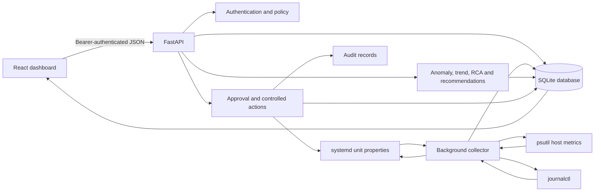
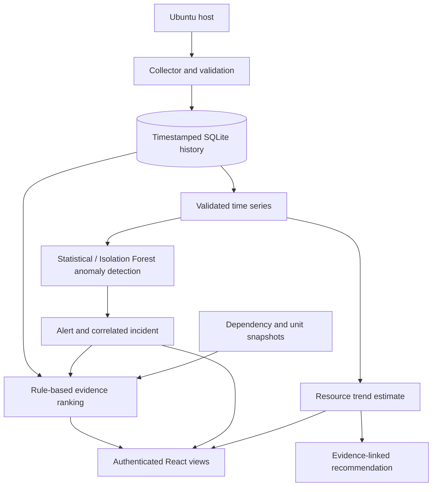

# System architecture

## Runtime components

The React client reads real API data and displays explicit empty/error/staleness states. FastAPI serves authenticated workflows. A managed background thread collects on the configured interval; stored metrics are also used for chronological resource forecasts and anomaly detection. The administration action state machine shares policy, impact, risk, persistence and audit records.

## Trust boundaries

- The browser is an untrusted client. All request fields are validated server-side.
- The API has an OS identity distinct from the browser user. Linux deployments should use a dedicated account and narrowly scoped systemd permissions.
- The SQLite file contains account hashes and operational history. Its directory requires access control and backups.
- systemd and journal data are unavailable on Windows; the health response advertises this rather than synthesizing Linux results.

## Data flow

Storage is SQLite in this implementation, preserving the existing repository's selected database. PostgreSQL is not part of the delivered runtime.
