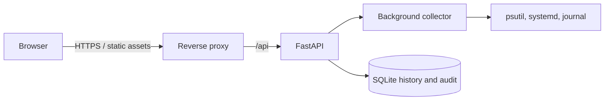

# Ubuntu deployment

The backend must run on the Linux host whose metrics and systemd units it will inspect. The frontend can be served separately. The project has been developed and API-tested on Windows; validate the commands and permission policy on the target Ubuntu release before production use.

## Architecture



## Install

Create a dedicated account, install the repository under `/opt/linux-admin-platform`, and configure a durable data directory. Set a strong initial password, exact browser origin, service allowlist and desired thresholds in the root `.env` file. Keep `.env`, database backups, and application secrets out of Git.

```bash
sudo useradd --system --home /opt/linux-admin-platform --shell /usr/sbin/nologin lap
sudo install -d -o lap -g lap /var/lib/linux-admin-platform
cd /opt/linux-admin-platform
python3 -m venv .venv
. .venv/bin/activate
python -m pip install -r backend/requirements.txt
```

Set `DATABASE_PATH=/var/lib/linux-admin-platform/platform.db`. Restrict ownership and mode on the database directory. For service controls, grant the dedicated account only the named systemctl actions required by `ALLOWED_SERVICES`; do not grant a general root shell or unrestricted sudo. Journal visibility may require a deployment-specific group. Confirm that the configured allowlist and `PROTECTED_SERVICES` reflect local policy.

## systemd service example

Create `/etc/systemd/system/linux-admin-platform.service` and adapt paths and environment file location:

```ini
[Unit]
Description=Linux Admin Intelligence Platform API
After=network-online.target
Wants=network-online.target

[Service]
Type=simple
User=lap
Group=lap
WorkingDirectory=/opt/linux-admin-platform/backend
EnvironmentFile=/opt/linux-admin-platform/.env
Environment=PYTHONPATH=/opt/linux-admin-platform/backend
ExecStart=/opt/linux-admin-platform/.venv/bin/python -m app
Restart=on-failure
RestartSec=5
NoNewPrivileges=true
PrivateTmp=true
ProtectSystem=strict
ProtectHome=true
ReadWritePaths=/var/lib/linux-admin-platform

[Install]
WantedBy=multi-user.target
```

Then run `sudo systemctl daemon-reload`, `sudo systemctl enable --now linux-admin-platform`, and check `systemctl status linux-admin-platform` and `journalctl -u linux-admin-platform`. Confirm the API health route reports collector success and Linux integration availability.

## Frontend and proxy

Build with `cd frontend && npm ci && npm run build`. Serve `frontend/dist` using a production web server and proxy `/api/` to `127.0.0.1:8000`. Terminate TLS at the trusted proxy, restrict network access, and set `CORS_ORIGINS` to the actual frontend origin. Do not expose the Vite development server publicly.

## Backups and operations

Use SQLite's online backup API or a stopped-service backup; do not copy a live database file without a consistent snapshot. Test restore procedures. Monitor free disk space, collector freshness, service health, and backup success. `RETENTION_DAYS` prunes collected metric/process/service/log/prediction history; choose the retention period and backup policy together. Service operations remain human-reviewed and are revalidated when executed.

## Verification checklist

- `GET /api/health` reports collector status `running` and `linux_integration: true`.
- Metric timestamps advance and contain real host measurements.
- Service inventory, dependency graph, and journal views show expected access.
- A non-disruptive allowlisted action follows request, independent approval where policy requires it, execution, state verification, and audit recording.
- Stop requests for protected services are rejected.
- Restore a database backup in a separate test environment.

These checks are instructions for a real target host; they are not represented as evidence collected in the current Windows workspace.
