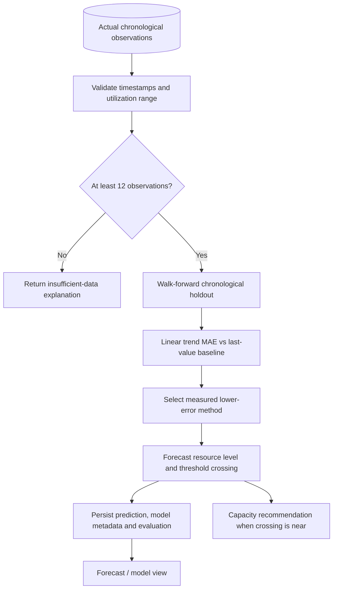
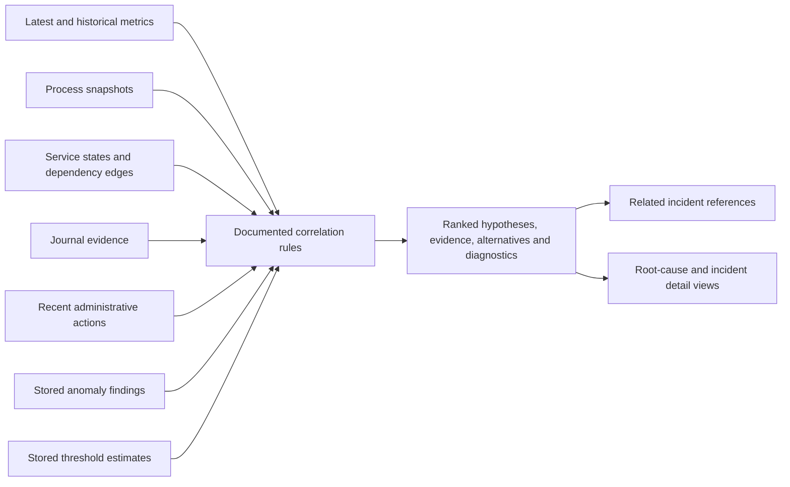
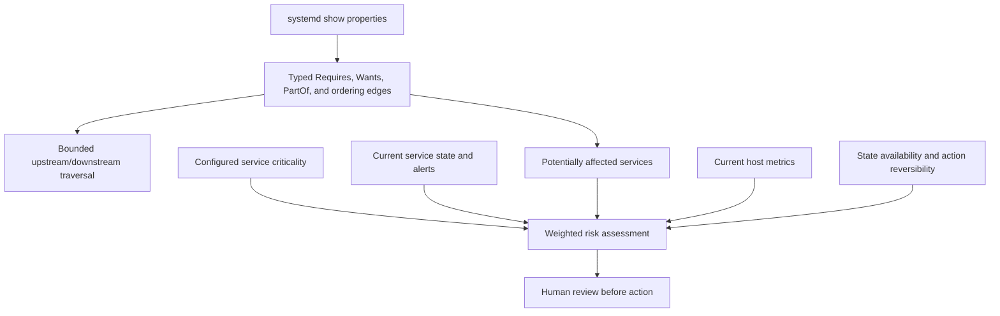
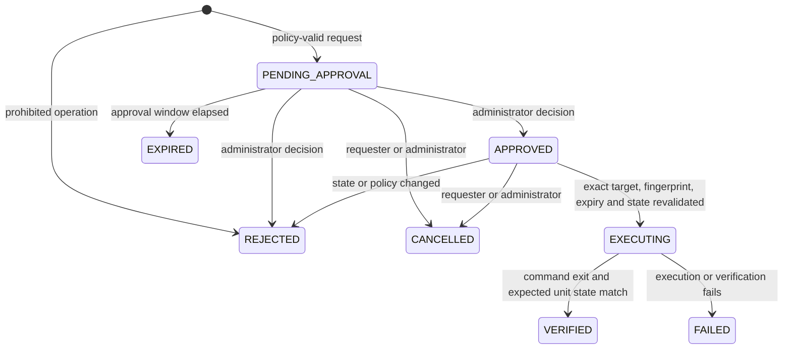
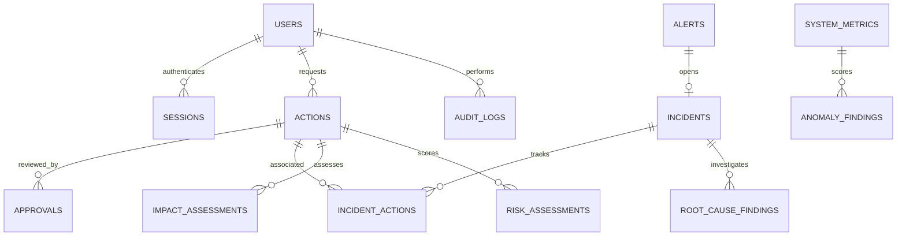

# System design and workflows

## Monitoring and anomaly path

```mermaid
flowchart LR
  Sample[psutil and Linux interfaces] --> Validate[Finite range and availability checks]
  Validate --> Persist[Timestamped metrics and process snapshots]
  Persist --> Window[Recent actual observation window]
  Window --> Detector[Isolation Forest or robust MAD]
  Detector --> Finding[Score, method, metric, baseline, explanation]
  Finding --> Dedup[Unique metric observation and alert deduplication]
  Dedup --> Incident[Alert-linked incident]
  Finding --> UI[Alerts and anomalies view]
  Incident --> UI
```

Rule threshold alerts and statistical anomaly findings are separate evidence types. An anomaly is not a confirmed failure. Findings are persisted and can be acknowledged/resolved; alert deduplication remains open through acknowledgement and permits a new alert after resolution.

## Prediction path

The target is a resource utilization trend, not a labeled future system failure. The displayed data-quality score is derived from held-out error and is not a probability.

## Root-cause investigation

The engine records correlation evidence and explicit alternatives. It does not infer causation from association.

## Dependency and impact path

Dependency source, relationship type, host coverage, and unknown state are surfaced. Ordering edges are not treated as functional dependencies.

### Risk formula

For each normalized factor `f` in 0–1, the score is `round(Σ(weight[f] × f × 100))`, clipped to 0–100. The configured default weights are:

| Factor | Weight |
| --- | ---: |
| Service criticality | 0.20 |
| Affected dependencies | 0.18 |
| Current service health | 0.15 |
| Active alerts and incidents | 0.14 |
| Resource pressure | 0.10 |
| Reversibility | 0.10 |
| Recovery readiness | 0.08 |
| Evidence quality | 0.05 |

Weights total 1.00. Default bands are LOW 0–30, MEDIUM 31–60, HIGH 61–80 and CRITICAL 81–100; `RISK_MEDIUM_MIN`, `RISK_HIGH_MIN` and `RISK_CRITICAL_MIN` can override band boundaries. These policy values are documented defaults, not universal calibrated probabilities. Protected operation and authorization rules are evaluated separately and cannot be bypassed by a low score.

## Approval and execution workflow

The action request is bound to a fixed operation and allowlisted service. Risk does not override authorization or protected-service policy. Execution uses argument arrays and a timeout; no raw user command is run.

## Database relationship overview

The current database is a single-host SQLite schema with inline idempotent bootstrap/additive columns. It does not implement SQLAlchemy/Alembic migrations or a PostgreSQL dialect.
